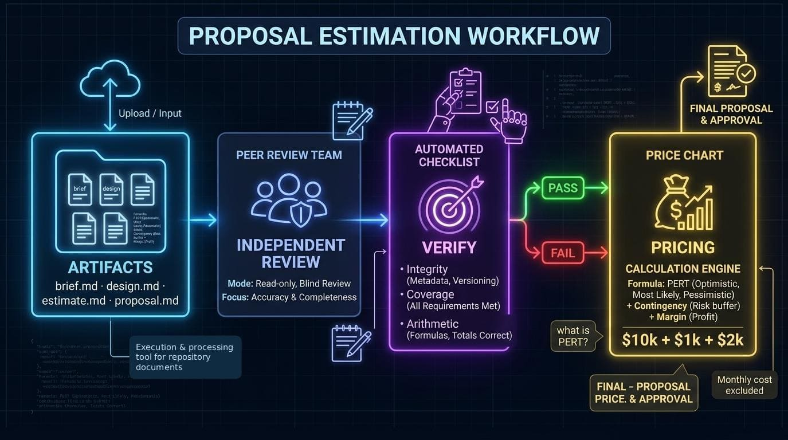

# Funky Forge 👻

Plan and quote software projects in four gated phases: problem, design, estimate, proposal.
A portable skill pack for any agent harness, plus a small deterministic CLI that refuses to let the
method's own rules be broken by accident.

The point is a price you can defend: every number traces back to a written artifact, an independent
review, and a human decision — instead of a spreadsheet nobody remembers building.

<p align="center">
  
</p>

## Why this exists

This started as a note to myself. I did not know how to organize a project before writing code, and I
did not know how to charge for one once it was finished: the scope lived in my head, the price was a
guess, and the guess was wrong in the direction that costs money.

Writing the four artifacts down, in order, with something that refuses to let them contradict each
other, fixed more than I expected. If you recognize yourself in that, this is for you — especially if
you are just starting out. The juniors closest to me are the reason this was written down at all.

## Who this is for

Two people read this page, and they are not the same. Neither gets a reduced version: the same four
artifacts carry what a lead already knows how to decide and what a beginner would not yet know to
ask. This is not a training-wheels tool a senior has to outgrow.

**You have never planned a project, or never had to say what one costs.** The method asks the
questions you would not know to ask: who this is for, what is deliberately out of scope, what breaks
first, how many hours each work block really takes, what the contingency is for, how much margin you
need to stay in business. The templates carry that structure so you do not have to invent it, and
`check` names what is still missing instead of letting a vague document pass. You answer in your own
words; the tool refuses to invent the answer for you.

**You are senior, lead or freelance, and quoting is already part of the job.** You get the part that
usually lives only in your head: a phase graph where nothing advances on an unapproved artifact, four
artifacts that must agree with each other, an approval hash that invalidates itself the moment a file
changes after sign-off, arithmetic recomputed from the table rather than trusted, and a reviewer that
runs in its own session, blind to your conversation. Decisions that would otherwise pass unnoticed
get a gate and a name.

## What you get

- **Four artifacts that must agree**: `brief.md`, `design.md`, `estimate.md`, `proposal.md`, in
  `.funky-forge/` next to your code.
- **A reviewer per phase**: independent, read-only, and blind to your conversation.
- **A deterministic check**: schema, dependency chain, approval hash, arithmetic, component
  coverage, and gate reports — `check` either passes or names the file and the field.
- **A price with its arithmetic shown**: PERT hours per work block, contingency and margin with
  stated reasons, a range, and a monthly cost kept out of the price.

It plans and prices. It does not write your code, and it does not replace the person who decides the
project is worth doing.

## The four phases

| # | Phase | Question | Artifact |
|---|---|---|---|
| 1 | `problem` | Is this worth building, and for whom? | `brief.md` |
| 2 | `design` | What is the minimum design that satisfies the brief? | `design.md` |
| 3 | `estimate` | How much does it cost, and why? | `estimate.md` |
| 4 | `proposal` | What exactly is being sold? | `proposal.md` |

How a phase runs — gates, depth, verdicts, approval and staleness — is
[docs/method.md](docs/method.md); why a phase cannot approve its own work is
[docs/architecture.md](docs/architecture.md#who-decides-what); how the numbers are produced is
[docs/artifacts.md](docs/artifacts.md#estimate-blocks-and-pricing).

## Status

Pre-release, version `0.1.0`, published at
[MaxGB23/funky-forge](https://github.com/MaxGB23/funky-forge). The method was validated end to end on
two projects before any CLI code existed ([evidence](docs/validation/project-a.md)); the CLI is
covered by tests and has no runtime dependencies.

## Requirements

Node.js 22 or newer. No dependencies, no build step, no network access. npm works; pnpm is
recommended because we promote one practice whether or not this package needs it:
`minimumReleaseAge`, which refuses a version until it has been public for a while. Nothing here
ships dependencies, so the pin protects the machine that clones and builds the repository, not the
consumer. Why it is recommended anyway, and how to tune it:
[docs/cli.md](docs/cli.md#package-manager).

## Install

```sh
pnpm add --global funky-forge     # npm install --global funky-forge also works
funky-forge install               # inside the project you want to plan
funky-forge init
```

`install` copies the method into a harness skill directory and writes nothing else:

| Harness | Target | Flag |
|---|---|---|
| Pi, OpenCode, Codex, Antigravity CLI... | `.agents/skills/funky-forge/` | `--target agents` |
| Claude Code | `.claude/skills/funky-forge/` | `--target claude` |

Detection is automatic. When both harness markers exist the command refuses to guess, exits `2` with
`TARGET_AMBIGUOUS`, and prints the exact `--target` to use. To run from a clone instead:

```sh
git clone https://github.com/MaxGB23/funky-forge
pnpm add --global link:./funky-forge   # symlinks the clone; edits show up immediately
```

## Quick start

```sh
funky-forge init --language en --proposal-language es
# ... write .funky-forge/brief.md, then:
funky-forge check problem              # must pass before the gate
funky-forge check problem --json       # bodyHash, errors, warnings
funky-forge calc --write               # rewrite the estimate table
funky-forge check estimate --strict
```

## Documentation

| Document | What it answers |
|---|---|
| [docs/architecture.md](docs/architecture.md) | How the pieces fit: layers, data flow, phase graph, invariants, non-goals |
| [docs/method.md](docs/method.md) | How a phase runs: gates, depth, verdicts, approval, convergence, degraded modes |
| [docs/artifacts.md](docs/artifacts.md) | Every file format: frontmatter, statuses, hashing, required sections, gate reports, estimate schema |
| [docs/cli.md](docs/cli.md) | Commands, flags, exit codes, full error catalogue, JSON shapes, guarantees |
| [docs/validation/](docs/validation/) | Two complete projects planned with the method, with their findings |

Start with the method if you are learning the loop, and with the architecture if you want to know why
the tool cannot approve its own output.

## Harnesses and models

The method needs three capabilities: read files, write files, run a shell command. Results, however,
depend on what you configure: the orchestrator and each reviewer run on whatever your platform uses
— Claude Code, OpenCode, Antigravity CLI, Pi, or anything else — and a weak reviewer fails silently
by approving work that should not pass. Put your strongest reasoning model on the reviewer, then on
the `design` and `estimate` reviews, and keep the reviewer in a separate session. Details:
[docs/method.md](docs/method.md#review-quality-and-models).

## Development

```sh
pnpm test                # node --test, no dependencies to install
pnpm pack --dry-run      # inspect exactly what ships
node bin/funky-forge.js  # run the working tree without linking anything
```

`pnpm test` also fails if the generated help drifts from the command table, or if a documentation
link points at a file that does not exist.

## License

MIT
